  

# Hi, I'm Vishal Hilal

I'm a full-stack web developer. Most of my work is in React, Next.js, TypeScript and Node.js, with MongoDB or MySQL behind it. Lately I've been adding LLM features to the apps I build.

I like solving the same problem in different languages and paradigms, because it shows me how each one shapes the design.

## Tech stack

## What I'm learning right now

Most of my learning time goes into:

- Using Claude Code for everyday development
- Building MCP servers and connecting tools to them
- Function calling with LLM APIs
- RAG with vector search, mostly pgvector
- Writing prompts and managing context in real apps

## GitHub activity

